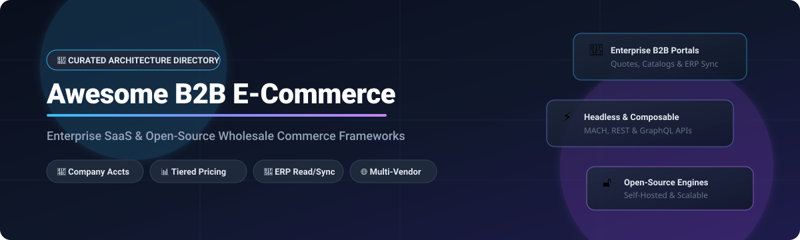

# Awesome-B2b-E-Commerce-Platform 🏢 🛒

  

  
  
  
  
  
  

---

## 🌟 Top B2B E-Commerce Platform Ecosystem

**Curated List of Commercial B2B Commerce Platforms & Open-Source E-Commerce Frameworks**  
*Focused on Wholesale Pricing, Quote Management, Company Accounts, ERP Integration, Headless Commerce & Self-Hosted B2B Storefronts*

**Last updated: October 2026** 📅

---

### 📌 Overview & SEO Summary
Welcome to the ultimate curated directory of **B2B e-commerce platforms**, **open-source wholesale commerce frameworks**, and **ERP-integrated storefront engines**. Whether you are looking for enterprise-grade commercial solutions (such as *Adobe Commerce*, *Shopify Plus*, and *commercetools*), or self-hostable open-source alternatives (like *Spree Commerce*, *GrandNode 2*, and *Sylius*), this list covers category leaders, quote-to-order workflows, and privacy-respecting B2B commerce.

**Key Market Context:**
- **Enterprise B2B platform scores are close but fit varies dramatically** — Adobe Commerce leads a 2026 scorecard at **7.1**, with Shopify Plus at **7.0** and BigCommerce B2B at **6.9**. Adobe Commerce stands out for **native B2B feature depth**; Shopify Plus for **speed to market and 3-year TCO**; BigCommerce for **value**; SFCC for **Salesforce-centric businesses**; commercetools for **composable architecture** [citation:1].
- **Shopify B2B is available on all plans** (Basic, Grow, Advanced, Plus), but **unlimited catalogs, direct company catalog assignment, and advanced payments (deposits, partial payments, per-fulfillment requests) are exclusive to Shopify Plus** [citation:3][citation:13].
- **BigCommerce B2B Edition charges zero transaction fees** regardless of payment processor — a **$75,000–$125,000/year advantage** over Shopify Plus for a $50M GMV merchant using a third-party processor [citation:4].
- **Adobe Commerce license costs scale with GMV**, typically **$40,000–$190,000/year** for cloud deployments, before hosting and implementation [citation:6].
- **Sana Commerce is purpose-built for B2B manufacturing and distribution**, reading **live from SAP ERP** on every product list, product page, and checkout — no middleware, no separate commerce data layer [citation:18].
- **Spryker's Recurring Orders feature** (Early Access) lets B2B buyers set up **automated repeat purchases** with weekly, bi-weekly, monthly, or every-N-weeks cadence, with **pre-trigger notifications, review-required states for price increases, and pause/skip/resume actions** [citation:19].
- **Spree Commerce is the leading open-source B2B platform** — **zero platform fees, BSD 3-Clause license, REST APIs, TypeScript SDKs, production-ready Next.js storefront, B2B price lists with volume tiers, customer groups, companies with locations and tax exemptions, and storefronts gated to approved buyers** [citation:10].
- **GrandNode 2** is an **open-source .NET 10 + MongoDB platform** with **multi-store, multi-vendor marketplace, B2B/B2C from the same catalog, tier prices, sales employees, and REST API for headless storefronts** [citation:20].

---

## 📑 Table of Contents
- [🏢 SaaS & Commercial Platforms](#-saas--commercial-platforms)
- [🔓 Open-Source GitHub Projects](#-open-source-github-projects)
- [🛠️ How to Contribute](#%EF%B8%8F-how-to-contribute)
- [📊 Star History](#-star-history)
- [🤝 Support & Sponsorship](#-support--sponsorship)
- [⚠️ Disclaimer](#%EF%B8%8F-disclaimer)

---

## 🏢 SaaS / Commercial Platforms

> 📈 **Market Size & Industry Structure:** The global B2B e-commerce sector is projected to reach **$28.0–$36.2 Trillion in 2026** (expanding from ~$24.1T in 2025). The sector is **moderately fragmented** rather than winner-take-all, because specialized procurement requirements, deep ERP integrations (SAP, Oracle, Microsoft Dynamics), complex distributor pricing tiers, and regional industry compliance prevent any single platform from capturing total market share.

The B2B e-commerce market spans **enterprise commerce suites** (Adobe Commerce, SAP Commerce Cloud) that provide **native B2B feature depth with ERP integration**, **SaaS platforms** (Shopify Plus, BigCommerce B2B Edition) that offer **faster time-to-market and transparent pricing**, and **composable platforms** (commercetools) that provide **API-first architecture for custom builds**. **Adobe Commerce** leads a 2026 enterprise scorecard at **7.1**, with **native B2B features including company accounts, negotiated pricing, requisition lists, and shared catalogs** [citation:1][citation:11]. **Shopify Plus** scores **7.0** with **unlimited B2B catalogs, direct company catalog assignment, and advanced payments** [citation:3]. **BigCommerce B2B Edition** starts at **~$2,400/month** for enterprise with **zero transaction fees** [citation:4][citation:14]. **commercetools** is the **composable commerce leader**, offering **API-first, cloud-native, microservices architecture** with **AI-first capabilities and MACH Alliance founding membership** [citation:5][citation:15].

| SaaS / Commercial Platform | Company / Owner | Valuation / Market Cap / Revenue | Standard Edition Starting Price | Free Tier / Free Trial Limits | Description |
| :--- | :--- | :--- | :--- | :--- | :--- |
| **[Salesforce B2B Commerce](https://www.salesforce.com/)** ☁️ | Salesforce | ~$250 Billion (Market Cap) | **Starts at ~1%–2% of GMV** (Growth ~$10,000+/mo min contract) [citation:1] | **No free tier**; 30-day Developer Edition sandbox & guided demo | **CRM-native B2B commerce** — **Salesforce-centric businesses see best fit** [citation:1]. **Scored higher on service and support, integration and deployment, and evaluation and contracting in Gartner Peer Insights** [citation:11]. |
| **[SAP Commerce Cloud](https://www.sap.com/products/crm/commerce-cloud.html)** 🔷 | SAP SE | ~$200 Billion (Market Cap) | **~$150,000–$300,000/year** (GMV & order-tiered) | **No free tier**; interactive self-guided learning trails & demo available | **Enterprise B2B commerce** — **B2B Accelerator with organization management, quotes, order attachments, and SAP S/4HANA document flow** [citation:7][citation:17]. **B2B storefront features: account summaries, unit-level orders, future stock, scheduled replenishment** [citation:7]. **On-premise reaching end of mainstream maintenance July 2026** [citation:18]. |
| **[Adobe Commerce](https://business.adobe.com/products/magento/magento-commerce.html)** 🎨 | Adobe | ~$200 Billion (Market Cap) | **~$40,000–$190,000/year** (GMV-based Cloud) [citation:6] | **No free tier**; guided interactive sandbox demo upon request | **Enterprise B2B commerce** — **2026 enterprise scorecard leader at 7.1** [citation:1]. **Native B2B features: company accounts, negotiated pricing, requisition lists, shared catalogs, quote workflows** [citation:11]. **API-first and modular architecture for SAP S/4HANA, Salesforce, and Akeneo integration** [citation:11]. |
| **[Shopify Plus](https://www.shopify.com/plus)** 🛍️ | Shopify Inc. | ~$100 Billion (Market Cap) | **$2,300/month** (3-yr contract) / **$2,500/month** (1-yr) | **3-day free trial** (unlimited store sandbox, 0 live transactions without plan); no permanent free tier | **Enterprise DTC & B2B commerce** — **2026 scorecard at 7.0** [citation:1]. **B2B available on all plans** (Basic, Grow, Advanced, Plus) [citation:3][citation:13]. **Plus unlocks unlimited B2B catalogs, direct company catalog assignment, deposits, partial payments, and per-fulfillment payment requests** [citation:3]. |
| **[commercetools](https://commercetools.com/)** 🔧 | commercetools | ~$1.9 Billion (Valuation) / ~$175M ARR | **~$40,000–$50,000/year** (Core edition, order-based) [citation:5] | **60-day free trial** with full Merchant Center and core API access (no credit card required); no free production tier | **Composable commerce platform** — **MACH Alliance founding member** [citation:15]. **API-first with REST and GraphQL, cloud-native, microservices, multi-tenant, versionless** [citation:5]. **AI-first architecture with structured commerce data for agentic commerce** [citation:5]. |
| **[BigCommerce B2B Edition](https://www.bigcommerce.com/)** 🏪 | BigCommerce Holdings | ~$500 Million (Market Cap) | **~$2,400/month** (Enterprise B2B bundle) [citation:4] | **15-day free trial** with unlimited products and storefront testing; no permanent free tier | **B2B commerce with zero transaction fees** — **no revenue share regardless of payment processor** [citation:4]. **B2B Edition bundles buyer portals, quote management, net payment terms, and company account hierarchies** [citation:4]. **A $50M GMV merchant saves $75K–$125K/year vs Shopify Plus with third-party processor** [citation:4]. |
| **[Spryker](https://spryker.com/)** 🎛️ | Spryker | ~$500 Million (Valuation) / ~€50M ARR | **~€100,000/year** (~$110,000–$180,000/yr starting license) | **No free tier**; 30-day AWS Marketplace evaluation sandbox / guided demo upon request | **Composable B2B commerce** — **Headless architecture with individualization possibilities** [citation:11]. **Recurring Orders feature (Early Access): weekly, bi-weekly, monthly, or every-N-weeks automated repeat purchases with notifications and review-required states** [citation:19]. **Upgraded to PHPUnit 12, PHPStan 2.x, and Angular 20** [citation:9]. |
| **[Elastic Path](https://www.elasticpath.com/)** 🛒 | Elastic Path | ~$75 Million ARR / >$110M funding | **$49,500/year** (~$4,125/month entry tier) | **14-day free trial** with guided PXM sandbox and developer API access; no permanent free tier | **Composable commerce platform** — **API-first, headless architecture for B2B and B2C** . |
| **[Sana Commerce](https://www.sana-commerce.com/)** 🇳🇱 | Sana Commerce | ~$55M–$105 Million ARR (est.) | **~$1,000–$3,000/month** (Essential tier) [citation:8] | **No free tier**; interactive ERP-integrated demo environment upon request | **ERP-integrated B2B commerce** — **Reads live from SAP ERP on every product list, page, and checkout** — no middleware, no separate data layer [citation:18]. **Purpose-built for equipment, parts, and consumables with visual/guided part search, exploded views, and reorder tools** [citation:18]. **SaaS only** [citation:18]. |
| **[OroCommerce](https://oroinc.com/b2b-ecommerce/)** 🏢 | Oro Inc. | ~$32 Million ARR (est.) | **~$35,000–$45,000/year** (Enterprise Cloud) | **Free forever Community Edition** (self-hosted, open source under OSL-3.0); 30-day Enterprise cloud demo sandbox | **B2B commerce platform** — **Built for complex B2B manufacturers, distributors, and wholesalers** . **Native CRM integration and workflow automation** . |

---

## 🔓 Open-Source GitHub Projects

*Sorted by GitHub_Stars_Count (Descending)* 🌟

- **[Medusa](https://github.com/medusajs/medusa)**  ⚡  
  **The modular open-source commerce framework for developers**, MIT licensed. Built with Node.js/TypeScript and PostgreSQL. Provides headless building blocks, custom B2B promotions, multi-region tax/pricing logic, quote requests, and 20+ extensible commerce modules for custom wholesale workflows. 🛒

- **[Bagisto](https://github.com/bagisto/bagisto)**  🛍️  
  **Open Source Laravel B2B & B2C E-Commerce Platform**, MIT licensed. Features native B2B marketplace extensions, wholesale quotation requests, multi-currency, multi-inventory sources, tiered customer group pricing, and a modern admin dashboard built on Laravel and Vue.js. 📦

- **[Saleor](https://github.com/saleor/saleor)**  🎯  
  **Leading open-source MACH commerce platform**, BSD-3-Clause licensed. High-performance Python/Django backend with GraphQL-first API, channel-based catalogs, customer group volume discounts, automated warehouse assignments, and extensible Next.js storefronts. 🚀

- **[Spree Commerce](https://github.com/spree/spree)**  🏢  
  **Open Source Platform for DTC, B2B Commerce, Marketplaces & Omnichannel**, BSD 3-Clause licensed. **Zero platform fees** [citation:10]. **B2B & Wholesale features**: price lists with volume tiers, customer groups, companies with locations, contacts and tax exemptions, catalogs for per-segment assortments, and gated buyer storefronts [citation:10]. **REST API with three TypeScript SDKs**, React Admin Dashboard (Vite + shadcn/ui), and Next.js 16 storefront [citation:10]. 💎

- **[nopCommerce](https://github.com/nopSolutions/nopCommerce)**  🔷  
  **Open-source ASP.NET Core e-commerce platform**, GPL-3.0 licensed. Mature architecture with multi-store, multi-vendor marketplace, corporate account tiers, volume-based pricing, tax calculation plugins, and ERP/CRM integration connectors built on .NET and MS SQL/MySQL/PostgreSQL. 💻

- **[Sylius](https://github.com/Sylius/Sylius)**  🎛️  
  **Headless e-commerce framework for Symfony (PHP)**, MIT licensed. Full developer control over data models, business logic, and custom checkout flows. Sylius Plus adds advanced RBAC, multi-source inventory, and B2B quote-to-order pricing engines. Used by Carrefour, Forbes, and Mytheresa. 🐘

- **[Vendure](https://github.com/vendure-ecommerce/vendure)**  ⚡  
  **TypeScript-first headless commerce framework**, MIT licensed. Built on NestJS, GraphQL, and PostgreSQL/MySQL. Uses Strategy patterns for wholesale custom business logic, tax calculation, payment gateways, and B2B company order approval flows. 🚀

- **[Solidus](https://github.com/solidusio/solidus)**  🛡️  
  **Open-source, battle-tested eCommerce framework for Ruby on Rails**, BSD-3-Clause licensed. High-stability commerce core powering large-volume enterprise retailers, customizable customer groups, multi-currency payment workflows, and wholesale account extensions. 🚂

- **[Shopware 6 Core](https://github.com/shopware/shopware)**  🇩🇪  
  **Open headless & API-first commerce engine**, MIT licensed. Built on Symfony and Vue.js. Offers a comprehensive B2B Suite with corporate accounts, budget and order approval workflows, custom quota management, and rule-based dynamic pricing for mid-market and enterprise manufacturers. 🛍️

- **[GrandNode 2](https://github.com/grandnode/grandnode2)**  🏬  
  **Open-source e-commerce platform for .NET 10 and MongoDB**, open-source. Multi-store, multi-vendor marketplace, B2B/B2C from the same catalog [citation:20]. B2B features: customer groups, tier prices, dedicated sales rep assignment, and REST API for headless integrations [citation:20]. 🔧

- **[OroCommerce](https://github.com/oroinc/orocommerce)**  🏗️  
  **Flexible B2B commerce platform**, OSL-3.0 licensed. Community Edition on Symfony with native B2B workflows: corporate accounts hierarchy, buyer permissions, multi-tier pricing, RFQ (Request for Quote) management, and CRM integration. ⚙️

---

## 🛠️ How to Contribute

Contributions are welcome! Follow these steps to submit new B2B e-commerce platforms or open-source commerce software:

1. 🍴 **Fork** the repository.
2. 📝 **Add/edit** entries in `README.md` maintaining table/list structure and formatting.
3. 🔗 Include project title, official website/GitHub link, exact Stars_Count, license, and brief description.
4. 🚀 Submit a **Pull Request** with a descriptive summary of your changes.

---

## 📊 Star History

---

## 🤝 Support & Sponsorship

If you find this B2B e-commerce repository useful, please consider supporting the project:

- ⭐ **Star** this repository to increase visibility!
- 🔀 **Fork** and share with fellow commerce architects, B2B operators, and open-source advocates.
- ☕ **Sponsor & Buy Me a Coffee**: Support ongoing open-source curation via the [GitHub Sponsor Dashboard](https://github.com/sponsors/ishandutta2007).

---

## ⚠️ Disclaimer

- This is a **community-curated** list — not exhaustive and not an endorsement. ℹ️
- **Adobe Commerce, SAP Commerce Cloud, Salesforce B2B Commerce, and commercetools do not publish pricing** — **all require sales engagement for quotes** . **Adobe Commerce license costs scale with GMV, typically $40,000–$190,000/year for cloud deployments** [citation:6]. **BigCommerce B2B Edition starts at ~$2,400/month with zero transaction fees** [citation:4].
- **Shopify Plus unlocks critical B2B features** — **unlimited catalogs, direct company catalog assignment, deposits, partial payments, and per-fulfillment payment requests are Plus-exclusive** [citation:3]. **BigCommerce charges zero transaction fees regardless of processor, saving $75K–$125K/year at $50M GMV** [citation:4].
- **SAP Commerce Cloud on-premise reaches end of mainstream maintenance in July 2026** — **plan migration to cloud or a specialist B2B layer** [citation:18]. **Sana Commerce reads live from SAP ERP on every product list, page, and checkout** — **no middleware, no separate data layer** [citation:18].
- **Open-source B2B commerce platforms are not turnkey** — **Spree requires Node.js 24+ and Docker** [citation:10]. **GrandNode 2 requires .NET 10 SDK, MongoDB 4.0+, and Node.js 22/24 LTS** [citation:20]. **Sylius requires PHP and Symfony expertise** . **Always validate B2B pricing logic, ERP integration, and quote-to-order workflows with a proof-of-concept** before production deployment. 🛒

---

  <b>Made with ❤️ for commerce architects, B2B operators, and open-source commerce advocates.</b>

